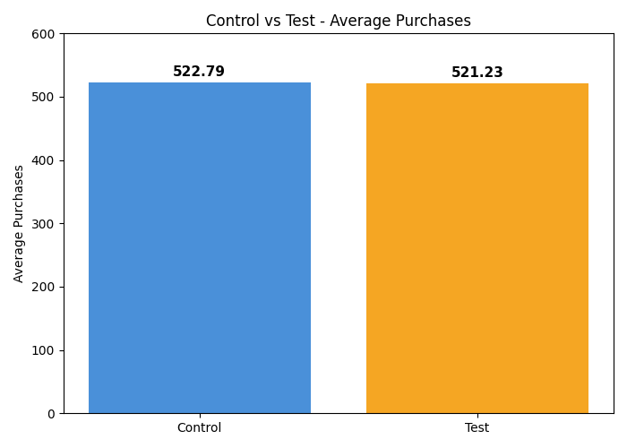

# A/B Testing - Marketing Campaign Analysis

## Project Overview

This project analyzes an A/B test to determine whether a new marketing campaign (Test Group) performs better than the existing campaign (Control Group). Using statistical hypothesis testing, the analysis compares average purchases and evaluates whether the observed difference is statistically significant.

## Objective

- Compare purchase performance between control and test groups
- Calculate average purchases and percentage lift
- Perform hypothesis testing using the two-sample t-test
- Provide a data-driven recommendation

## 🛠️ Tools & Technologies

- Python
- Pandas
- Matplotlib
- SciPy
- Visual Studio Code

## Dataset

The project uses two datasets:

- `control_group.csv`
- `test_group.csv`

These datasets contain marketing campaign metrics such as impressions, clicks, and purchases.

## Methodology

1. Load and combine both datasets
2. Clean and standardize column names
3. Convert Purchase column to numeric and remove missing values
4. Calculate average purchases for each group
5. Perform two-sample t-test
6. Compute lift percentage
7. Visualize the average purchases comparison

## Key Results

- Control Average Purchases: 522.79
- Test Average Purchases: 521.23
- Lift: -0.30%
- P-value: 0.976
- Conclusion: No statistically significant difference (p > 0.05). The new campaign did not improve purchases, so we fail to reject the null hypothesis.

## Average Purchases Comparison

## Business Insight

The analysis helps determine whether the experimental campaign generated a meaningful improvement in purchases. Statistical significance testing ensures that decisions are based on evidence rather than random variation.

**Recommendation: DO NOT launch the new campaign.** It shows no benefit over the existing campaign.

## Skills Demonstrated

- A/B Testing
- Hypothesis Testing
- Statistical Analysis
- Data Cleaning
- Data Visualization
- Business Analytics

## Future Improvements

- Add confidence intervals
- Segment analysis by campaign type / customer group
- Build an interactive dashboard in Power BI

## Author

Abhilasha mp
